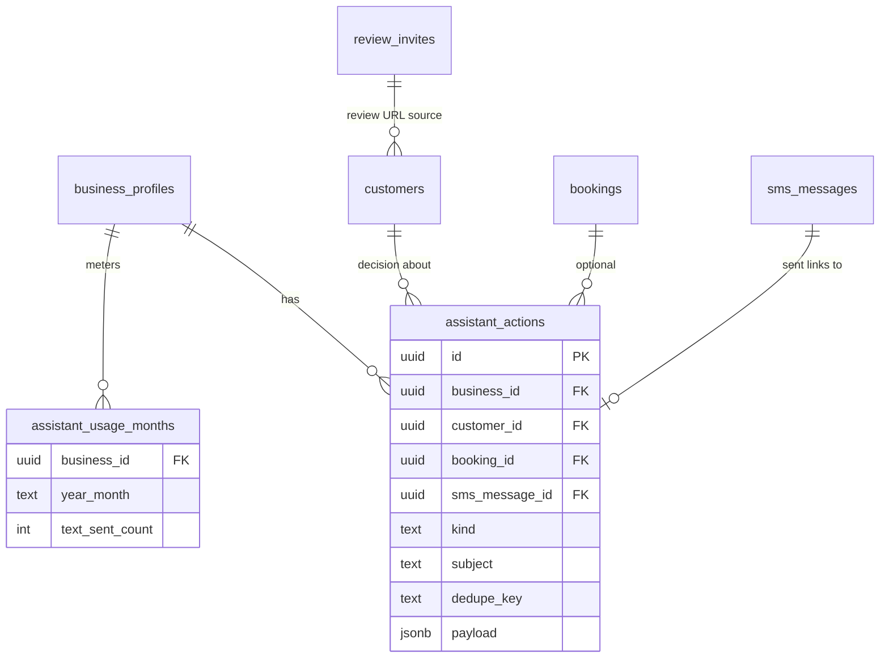

# Assistant — database reference

Schema and behavior for **`assistant_actions`** and **`assistant_usage_months`**, plus the external tables Assistant reads/writes through.

- **Flows (start here for product):** [FLOWS.md](./FLOWS.md)
- **Migrations:** [`001_assistant_actions.sql`](./migrations/001_assistant_actions.sql) → [`002_assistant_usage_months.sql`](./migrations/002_assistant_usage_months.sql)
- **Per-table detail:** [ASSISTANT_ACTIONS_TABLE.md](./ASSISTANT_ACTIONS_TABLE.md), [ASSISTANT_USAGE_MONTHS_TABLE.md](./ASSISTANT_USAGE_MONTHS_TABLE.md)

---

## Tables at a glance

| Table | Role | Who writes |
| --- | --- | --- |
| `assistant_actions` | Append-only decisions (skip / send / unskip) | **service_role** only |
| `assistant_usage_months` | Monthly outbound text meter | **service_role** only |
| `sms_messages` | Delivery log (shared SMS feature) | **service_role** via `sendAndRecordSms` |
| `review_invites` | Unique review tokens (shared reviews feature) | **service_role** at Send for reviews |

Owners and active **managers** may **SELECT** the two Assistant tables. Authenticated clients cannot INSERT/UPDATE them.

---

## Relationship diagram



---

## Design principles

1. **Compute due on read** — never persist “suggestions.” Only persist decisions and usage.
2. **Two logs, clear jobs** — `assistant_actions` = owner intent / suppression; `sms_messages` = carrier delivery.
3. **Quota after delivery** — `text_sent_count` increments only when a send is accepted as delivered (see FLOWS).
4. **Idempotent sends** — unique `(business_id, dedupe_key)` on actions; SMS dedupe per UTC day.

---

## Read path (today)

`loadAssistantToday` SELECTs:

| Table | Why |
| --- | --- |
| `business_profiles` | Booking / book URL for check-in copy |
| `customers` | Name, phone, email |
| `bookings` | Last visit, upcoming, `lastVisitBookingId` |
| `reviews` | Exclude customers who already reviewed |
| `assistant_actions` | Latest decisions for suppression + activity |

No writes on page load.

---

## Write path (send)

| Step | Table / system |
| --- | --- |
| Mint review URL | `review_invites` (rotate or insert) |
| Send SMS | `sms_messages` + Telnyx |
| Record decision | `assistant_actions` (`kind = sent`, optional `sms_message_id`) |
| Meter | `assistant_usage_months` upsert `text_sent_count + 1` |

Skip only inserts `assistant_actions` (`kind = skipped`).

---

## RLS summary

| Table | SELECT | INSERT / UPDATE / DELETE |
| --- | --- | --- |
| `assistant_actions` | Owner + active manager | service_role only |
| `assistant_usage_months` | Owner + active manager | service_role only |

App routes use `createSupabaseAdminClient()` for writes after `requireBusinessPermission`.

---

## Example queries

**Usage this UTC month**

```sql
select text_sent_count
from assistant_usage_months
where business_id = $1
  and year_month = to_char(now() at time zone 'utc', 'YYYY-MM');
```

**Latest decision per customer for reviews**

```sql
select distinct on (customer_id)
  customer_id, kind, subject, created_at, sms_message_id
from assistant_actions
where business_id = $1
  and subject = 'review_followup'
  and customer_id is not null
  and kind in ('skipped', 'unskipped', 'sent')
order by customer_id, created_at desc;
```

**Assistant SMS in the shared log**

```sql
select id, type, to_phone, status, created_at, error
from sms_messages
where business_id = $1
  and type in ('assistant_review_followup', 'assistant_rebook_checkin')
order by created_at desc
limit 50;
```
