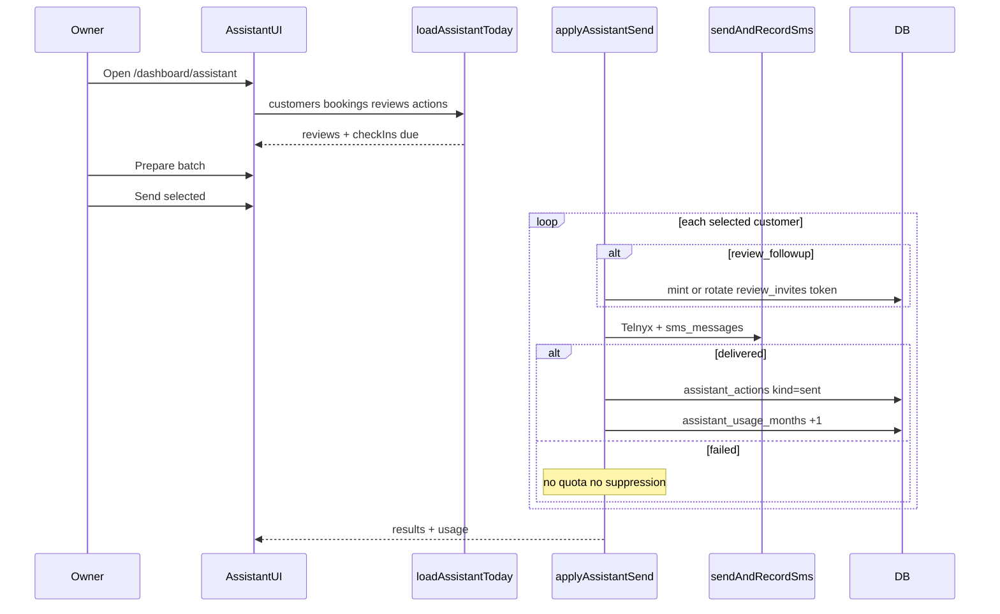

# Assistant — end-to-end flows

Human-readable reference for how Owner Assistant works today: product rules, due computation, prepare/send, SMS, quota, and APIs. Use for onboarding and AI context.

**Related docs**

| Doc | Use when |
| --- | --- |
| [DATABASE.md](./DATABASE.md) | Schema, RLS, related tables |
| [ASSISTANT_ACTIONS_TABLE.md](./ASSISTANT_ACTIONS_TABLE.md) | Decision log columns |
| [ASSISTANT_USAGE_MONTHS_TABLE.md](./ASSISTANT_USAGE_MONTHS_TABLE.md) | Monthly meter |
| Reviews [FLOWS.md](../../reviews/docs/FLOWS.md) | Invite / review link lifecycle |
| SMS `sendAndRecordSms` | Shared outbound delivery |

---

## Overview

Assistant is **suggest → approve → send**. Nothing texts a customer until the owner taps Send.

- **No cron** writes suggestions. Due lists are **computed on read** when the owner opens Assistant.
- **Decisions** (skip / send) are the only Assistant writes that change who appears next time.
- **SMS** goes through the shared Telnyx + `sms_messages` pipeline — same as booking texts.
- **Quota** (beta) lives in app config; the DB only stores how many were successfully sent this UTC month.



---

## Product rules (v1 / beta)

| Rule | Behavior |
| --- | --- |
| **Prepare only** | Owner must approve; no autonomous sends |
| **Reviews + check-ins only** | Quotes / invoices are computed in shared builders but hidden from UI for now |
| **No cron suggestions** | Due list = read-time rules over live CRM data |
| **Reachable customers** | Phone or email required to appear |
| **Review due** | Completed visit ≥ 3 days ago, no review yet, not suppressed |
| **Check-in due** | No upcoming booking, last visit &gt; 90 days ago, not suppressed |
| **Suppression** | Latest decision `sent` or `skipped` hides that customer+subject until `unskipped` or they leave a review |
| **No bombardment** | After Send, they stay off the list (no timed re-nudge yet) |
| **Beta quota** | `ASSISTANT_BETA_TEXT_LIMIT` = **30** texts / shop / UTC month |
| **Quota honesty** | Increment only after a real delivery (or same-day SMS duplicate) |
| **Partial batches** | Some can succeed; failures stay ready with toast / results |
| **Product copy** | Never call it “AI” or “Agent” in UI |

---

## Due computation (on read)

**Entry:** `loadAssistantToday` → `buildAssistantToday`

**Reads (no writes):**

- `business_profiles` — booking URL
- `customers` — name, phone, email
- `bookings` — last visit, upcoming, booking id
- `reviews` — who already reviewed
- `assistant_actions` — latest skip/send decisions

**Review follow-up** (`subject = review_followup`)

1. Customer has phone or email and a display name
2. `lastVisitDaysAgo >= 3` (`REVIEW_FOLLOWUP_AFTER_DAYS`)
3. No `reviews` row for that customer
4. Not suppressed for `review_followup`

**Rebook check-in** (`subject = rebook_checkin`)

1. Reachable + named
2. No upcoming appointment
3. `lastVisitDaysAgo > 90` (`REBOOK_CHECKIN_AFTER_DAYS` / needs-attention)
4. Not suppressed for `rebook_checkin`

**Draft bodies**

- Review: shared copy with placeholder `[review link]` (unique URL injected **at send**)
- Check-in: includes shop booking URL when available

Prepare shows at most **20** rows (`BATCH_LIMIT`).

---

## Suppression

`suppressedKeys` keeps the **latest** decision per `(customerId, subject)` among `skipped` | `unskipped` | `sent`.

| Latest kind | On due list? |
| --- | --- |
| `sent` | No |
| `skipped` | No |
| `unskipped` | Yes (if still due by data rules) |
| none | Yes (if due) |

There is **no** “show again in N days after send” rule yet. Re-ask would need either `unskipped` or a future cooldown rule.

---

## Prepare → Skip / Send

### Skip

1. `POST /api/assistant/skip` (`customers.write`)
2. Insert `assistant_actions` with `kind = skipped`
3. No SMS, no quota
4. Customer leaves the morning list on next load

### Send

1. `POST /api/assistant/send` (`customers.write`)
2. For each item (sequential, max 20):
   - Stop if monthly remaining is 0
   - **Reviews:** resolve unique invite URL (`resolveAssistantReviewInviteUrl`), replace `[review link]`
   - `sendAndRecordSms` with type `assistant_review_followup` or `assistant_rebook_checkin`
   - On success (or same-day SMS `duplicate`): write `assistant_actions` `kind = sent` + `sms_message_id`, then `+1` usage **only if** the action row was newly created
   - On failure: no action, no quota; item stays ready
3. UI: spinner **Sending**, toast on success/error, mark only successes as Sent

**SMS types**

| Subject | `sms_messages.type` |
| --- | --- |
| `review_followup` | `assistant_review_followup` |
| `rebook_checkin` | `assistant_rebook_checkin` |

**Dedupe keys**

| Layer | Key shape |
| --- | --- |
| `sms_messages` | `assistant:{customerId}:{subject}:{YYYY-MM-DD}` (UTC day) |
| `assistant_actions` sent | `sent:{customerId}:{subject}:{YYYY-MM-DD}` |
| `assistant_actions` skip | `skipped:{customerId}:{subject}:{ISO timestamp}` |

Failed SMS clears `sms_messages.dedupe_key` so retry the same day is allowed.

---

## Review links

Prepare UI **always** shows the `[review link]` placeholder (shared message must not show one customer’s URL for a multi-select).

At Send, `resolveAssistantReviewInviteUrl`:

1. Skip if already reviewed
2. Rotate token on pending invite (or create for last completed booking)
3. Return `/review/{rawToken}` URL
4. Inject into the message body before Telnyx

Same invite model as job-complete reviews; rotating invalidates older pending links for that customer.

---

## Quota (beta)

| Piece | Where |
| --- | --- |
| Limit | `ASSISTANT_BETA_TEXT_LIMIT` in `constants/assistantBetaLimits.ts` (**30**) |
| Meter | `assistant_usage_months` per `(business_id, year_month)` UTC |
| UI | Pill: “N of 30 texts this month” |
| Gate | Block Send when remaining is 0; mid-batch stop with `limit_reached` |

Paid tiers / higher caps are not wired yet — change the constant (and later env/plan) when pricing lands.

---

## Auth & permissions

| Surface | Permission |
| --- | --- |
| Dashboard page + `GET .../today` + `GET .../usage` + review-links | `customers.read` |
| `POST .../skip` + `POST .../send` | `customers.write` |

Writes to `assistant_*` and `sms_messages` use **service role** (admin client). Owners/managers only SELECT those tables via RLS.

Outbound SMS also respects:

- `isSmsOutboundEnabled`
- Telnyx configured
- `canBusinessSendCustomerSms` (optional owner-email allowlist)
- `customers.sms_opt_in`

---

## HTTP API

| Method | Path | Purpose |
| --- | --- | --- |
| `GET` | `/api/assistant/today` | Due list + usage |
| `GET` | `/api/assistant/usage` | Usage only |
| `POST` | `/api/assistant/skip` | Log skips |
| `POST` | `/api/assistant/send` | SMS + decisions + quota |
| `POST` | `/api/assistant/review-links` | Mint URLs (optional; Send also mints) |

Client paths: `features/assistant/constants/assistantApiPaths.ts` (keep in sync with `ROUTES`).

**Send body**

```json
{
  "items": [
    {
      "customerId": "uuid",
      "bookingId": "uuid|null",
      "subject": "review_followup|rebook_checkin",
      "body": "message text with optional [review link]"
    }
  ]
}
```

**Send success**

```json
{
  "success": true,
  "recorded": 2,
  "usage": { "yearMonth": "2026-11", "sent": 5, "limit": 30, "remaining": 25 },
  "results": [
    { "customerId": "…", "subject": "review_followup", "ok": true, "smsMessageId": "…" },
    { "customerId": "…", "subject": "review_followup", "ok": false, "reason": "sms_opt_out" }
  ]
}
```

---

## UI surfaces

| Route / view | Role |
| --- | --- |
| `/dashboard/assistant` | SSR loads today + usage → `AssistantPage` |
| Morning | Cards for reviews / check-ins + Ask-anything rail (chat not live yet) |
| Prepare | Table + shared message + quota pill + Skip / Send |
| Activity | Local/sample activity filter (decision rows also feed activity entries from actions) |

---

## Code map (server)

| Module | Responsibility |
| --- | --- |
| `today/loadAssistantToday.ts` | Fetch CRM rows + actions |
| `today/buildAssistantToday.ts` | Pure due rules + copy |
| `server/applyAssistantDecisions.ts` | Skip + Send orchestration |
| `server/recordAssistantActions.ts` | Insert decisions / dedupe keys / SMS types |
| `server/assistantUsageMonth.ts` | Read / reserve / release meter |
| `reviews/server/resolveAssistantReviewInviteUrl.ts` | Unique review URLs for Assistant |
| `sms/services/sendAndRecordSms.ts` | Shared delivery |

---

## Next (chat)

Ask-anything is **read-only tool calling** (on-demand fetch for this shop — not a fixed data pack; not MCP for owners). Full architecture, v1 tool list, and schema: **[CHAT.md](./CHAT.md)**. Do not overload `assistant_actions` for chat transcripts.
